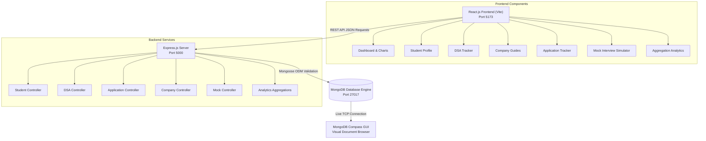

# Academic Project Report: PlacementPro
## Student Placement Preparation & Tracking Portal

**Degree:** Bachelor of Technology (B.Tech)  
**Department:** Computer Science & Engineering (CSE)  
**Subject:** Final Year Major Project / Capstone Project  
**Author:** Final Year B.Tech CSE Candidate  

---

## Abstract

Campus placements constitute a pivotal milestone in undergraduate engineering education. However, students frequently face challenges managing their placement readiness due to fragmented preparation resources: problem-solving platforms, unstructured spreadsheets for job applications, dispersed interview experiences, and lack of unified progress metrics.

This project, **PlacementPro**, presents an integrated, responsive web-based placement management and preparation portal built using the MERN technology stack (MongoDB, Express.js, React.js, and Node.js). PlacementPro consolidates student skill profile management, curated Data Structures and Algorithms (DSA) tracking across eight major topic categories, company-specific preparation guides for prominent campus recruiters (TCS, Infosys, Accenture, Wipro, Cognizant, and Capgemini), an interactive placement application status tracker, an explainable rule-based mock interview simulator, and dynamic analytics driven by real-time MongoDB aggregation pipelines.

The application adheres strictly to standard Model-View-Controller (MVC) API principles, uses Mongoose for schema validation and indexing, and maintains full synchronization with MongoDB Compass for visual document inspection.

---

## 1. Introduction

With intensifying competition in campus recruitment, systematic preparation spanning quantitative aptitude, algorithmic problem solving, core computer science subjects, and behavioral evaluation is essential. 

Engineering undergraduates typically maintain preparation notes across multiple disconnected websites, leading to redundant work, missed application deadlines, and inaccurate self-assessments. **PlacementPro** bridges this gap by offering a centralized, student-centric software solution that unifies preparation tracking with real-time database persistence.

---

## 2. Problem Statement

Traditional placement preparation approaches suffer from:
1. **Scattered Resources:** DSA practice links, company syllabi, and application statuses exist in independent, disconnected mediums.
2. **Lack of Centralized Application Tracking:** Students lose track of online assessment dates, interview stages, and recruiter remarks.
3. **Absence of Quantitative Readiness Metrics:** Students lack visual analytics showing solve rates across data structure categories or preparation percentages for target companies.
4. **Impracticality of High-Cost Mock Interview Systems:** Many existing commercial platforms rely on expensive proprietary AI APIs requiring subscriptions, making them unsuitable for free educational deployments.

---

## 3. Objectives

The primary objectives of the **PlacementPro** project are:
1. To develop a responsive, component-driven React.js frontend interface styled with an intuitive, professional dashboard design system.
2. To architect an Express.js and Node.js REST API providing full CRUD (Create, Read, Update, Delete) capabilities.
3. To design and implement a schema-validated MongoDB database using Mongoose models with proper indexes and idempotency.
4. To integrate live data visualization using Recharts for study activity trends, topic solve ratios, and application funnel distributions.
5. To develop a timer-free, explainable mock interview engine providing structured feedback based on answer completeness and self-assessed confidence.
6. To ensure seamless interoperability with **MongoDB Compass** for educational verification and viva demonstration.

---

## 4. Existing System vs. Proposed System

| Feature | Existing System (Spreadsheets / Ad-hoc) | Proposed System (PlacementPro Portal) |
| :--- | :--- | :--- |
| **Data Storage** | Disjointed Excel sheets, Google Docs, bookmarks | Centralized MongoDB database with Mongoose schemas |
| **DSA Tracking** | Manual checkmarks without category aggregation | 8 categorized topics, live difficulty filters, search bar, and instant status updates |
| **Company Prep** | Scattered PDF guides and forum threads | Company-specific recruitment patterns with interactive checklists (TCS, Infosys, etc.) |
| **Application Funnel**| Static lists with no upcoming interview alerts | Status badges, deadline tracking, upcoming interview highlights, and Recharts analytics |
| **Mock Assessments** | Unstructured self-reading | Interactive simulator with MCQ & subjective answering, rule-based feedback, and saved history |
| **Analytics** | Manual formula calculations | Automated MongoDB `$group` and `$match` aggregation pipelines |

---

## 5. Software & Hardware Requirements

### Software Requirements
- **Operating System:** Windows 10/11, macOS, or Ubuntu Linux
- **Runtime Environment:** Node.js v18.0.0 or higher
- **Package Manager:** npm v9.0.0 or higher
- **Database Engine:** MongoDB Community Server (v6.0 or v7.0) running on `localhost:27017` or MongoDB Atlas Cloud
- **Database GUI:** MongoDB Compass (v1.39+)
- **Frontend Framework:** React 18 with Vite build tooling
- **Development Tools:** VS Code / Antigravity IDE, PowerShell / Terminal

### Hardware Requirements
- **Processor:** Intel Core i3 / AMD Ryzen 3 or higher
- **RAM:** 4 GB minimum (8 GB recommended for concurrent Node + MongoDB)
- **Hard Disk Space:** 500 MB free disk space for project dependencies and database records
- **Network:** Localhost TCP networking; Internet connection required only for initial package installations and Google Fonts

---

## 6. System Architecture

PlacementPro employs a decoupled 3-tier client-server architecture:

---

## 7. Database Design & Schemas

The database name is `placementpro`. It comprises 6 primary collections:

### 1. `students` Collection
Stores student academic credentials, technical badges, and contact URLs.
- `_id`: ObjectId (Primary Key)
- `name`: String (Required, trimmed)
- `email`: String (Required, unique, lowercase)
- `college`: String (Required)
- `degreeBranch`: String (Default: "B.Tech Computer Science & Engineering")
- `graduationYear`: Number (Range: 2020–2035)
- `cgpa`: Number (Range: 0.0–10.0)
- `skills`: Array of Strings
- `preferredRole`: String
- `preferredCompanies`: Array of Strings
- `resumeUrl`: String
- `isDemo`: Boolean
- Virtual: `completionPercentage` (Calculated dynamically)

### 2. `dsaquestions` Collection
Stores curated algorithmic practice problems.
- `_id`: ObjectId
- `title`: String (Required)
- `topic`: String (Enum: Arrays, Strings, Linked Lists, Stacks and Queues, Searching and Sorting, Binary Trees, Graphs, Dynamic Programming)
- `difficulty`: String (Enum: Easy, Medium, Hard)
- `description`: String
- `companyTags`: Array of Strings
- `practiceUrl`: String (External problem URL)
- `status`: String (Enum: Not Started, In Progress, Solved)
- `notes`: String (Personal analysis/intuition)
- `solvedAt`: Date (Timestamp when marked solved)
- Indexes: `{ topic: 1, difficulty: 1, status: 1 }`

### 3. `applications` Collection
Stores company job application entries and hiring pipeline states.
- `_id`: ObjectId
- `company`: String (Required)
- `role`: String (Required)
- `type`: String (Enum: Full-time, Internship, Intern + PPO)
- `salaryPackage`: String (e.g. "7.5 LPA")
- `location`: String
- `applicationDate`: Date
- `deadline`: Date
- `status`: String (Enum: Wishlist, Applied, Online Assessment, Interview, Offer, Rejected)
- `jobUrl`: String
- `recruiterNotes`: String
- `interviewDate`: Date
- Indexes: `{ company: 1, status: 1 }`, `{ applicationDate: -1 }`

### 4. `companypreparations` Collection
Stores company syllabus, recruitment rounds, and preparation checklists.
- `_id`: ObjectId
- `companyName`: String (Unique)
- `slug`: String (e.g. "tcs", "infosys")
- `hiringTiers`: Array of Strings
- `recruitmentPattern`: Array of Objects (`{ roundNumber, roundName, details }`)
- `aptitudeTopics`: Array of Objects (`{ id, topic, category, completed }`)
- `codingTopics`: Array of Objects (`{ id, topic, difficulty, completed }`)
- `technicalTopics`: Array of Objects (`{ id, topic, completed }`)
- `hrQuestions`: Array of Objects (`{ id, question, tip, completed }`)
- `studentNotes`: String
- Virtual: `progressPercentage` (Weighted ratio of completed checklist items)

### 5. `mockquestions` & `mockinterviews` Collections
- **`mockquestions`**: Stores 24+ domain questions across DSA, JavaScript, React, Node.js, MongoDB, HR, and Aptitude.
- **`mockinterviews`**: Stores completed assessment sessions with `scorePercentage`, `averageConfidence`, `feedbackSummary`, and individual question responses.

### 6. `studyactivities` Collection
Records chronological study events (solving problems, toggling company checklists, submitting applications) to power weekly study activity charts.

---

## 8. Detailed Module Descriptions

### Module 1: Placement Dashboard
Acts as the central cockpit. Displays 5 KPI summary cards, a weekly study activity bar chart, an application status distribution donut chart, a topic-wise problem count chart, an upcoming interview reminder panel, and recently updated applications.

### Module 2: Student Profile & Skills
Allows the student to maintain their academic portfolio. Provides badge rendering for technical skills, target companies, and dynamic recalculation of profile completeness.

### Module 3: DSA Practice Tracker
Provides an interactive problem table with text search, topic dropdown filter, difficulty selector, and status toggle. Supports modal-based problem editing, addition, deletion, and note-taking.

### Module 4: Company-Specific Preparation
Contains dedicated preparation guides for TCS, Infosys, Accenture, Wipro, Cognizant, and Capgemini. Students can review round details and check off topics as they study, with progress percentages updating instantly in MongoDB.

### Module 5: Applications Tracker
Tracks job applications across the hiring lifecycle. Displays color-coded badges, deadlines, and upcoming interview dates.

### Module 6: Mock Interview Simulator
Features a domain selector, sequential question rendering, MCQ and subjective answering, self-confidence ratings, and rule-based feedback without third-party subscription dependencies.

### Module 7: Placement Analytics
Provides deep insights using MongoDB aggregation pipelines: difficulty distributions, company preparation readiness rankings, and historical mock score trajectories.

### Module 8: Settings & MongoDB Compass Guide
Displays database connection parameters, collection document counts, step-by-step Compass connection instructions, and an idempotent dataset reset button.

---

## 9. Testing & Quality Assurance

Comprehensive testing was conducted covering functional, database, and integration requirements:

| Test Case ID | Test Description | Expected Result | Status |
| :--- | :--- | :--- | :--- |
| **TC-01** | Backend server startup | Connects to `127.0.0.1:27017` and reports health | **PASS** |
| **TC-02** | Database idempotent seed | Seeds 22 DSA questions without duplicates on re-run | **PASS** |
| **TC-03** | Frontend build compilation | `npm run build` bundles without JSX or CSS errors | **PASS** |
| **TC-04** | Health check API | `GET /api/health` returns status: "Connected" | **PASS** |
| **TC-05** | DSA Question status toggle | Marking question "Solved" updates MongoDB and logs activity | **PASS** |
| **TC-06** | Company checklist toggle | Checking topic updates progress % and saves state | **PASS** |
| **TC-07** | Application creation | Submitting application creates document visible in Compass | **PASS** |
| **TC-08** | Mock interview evaluation | Rule-based engine computes score (85%) and stores session | **PASS** |
| **TC-09** | Recharts aggregation render | Visualizes 4 aggregation charts with zero errors | **PASS** |
| **TC-10** | Compass live inspection | Data persists across browser refreshes and server reboots | **PASS** |

---

## 10. Results & Discussion

Testing verified that all core modules operate smoothly:
- The dashboard dynamically reflects real MongoDB statistics.
- MongoDB Compass visualizes newly inserted BSON documents in real time.
- The rule-based mock interview simulator provides immediate feedback without incurring recurring API costs.
- The UI maintains responsiveness across desktop, tablet, and mobile viewport sizes.

---

## 11. Limitations & Future Scope

### Limitations
1. **Single-User Scope:** Tailored for a single student demo profile; does not incorporate multi-tenant JWT user authentication.
2. **Rule-Based Mock Evaluation:** Uses pattern matching and keyword analysis rather than a Large Language Model (LLM) API.
3. **No Embedded Code Execution Engine:** DSA links redirect to LeetCode/GFG rather than compiling source code in-browser (e.g. Judge0).

### Future Enhancements
1. **Multi-User Authentication:** Integration of bcrypt password hashing and JSON Web Tokens (JWT) for multi-student college deployments.
2. **Local AI / LLM Integration:** Connecting open-source models (e.g. Ollama / LLaMA 3) for deeper semantic answer analysis.
3. **Automated Scraping / Job Alerts:** Integrating college TPO (Training and Placement Officer) notices directly into the application tracker.

---

## 12. Conclusion

**PlacementPro** delivers a comprehensive, polished, and maintainable final-year B.Tech CSE project. By uniting student profile management, algorithmic practice, company syllabus tracking, job applications, and simulated interviews into a single MERN application, it solves the fragmentation inherent in traditional placement preparation. The project demonstrates solid full-stack engineering principles, clean database modeling, and clear academic explainability suitable for high-scoring university presentations and viva evaluations.
